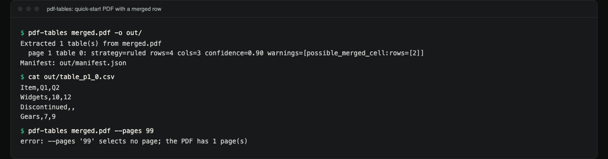
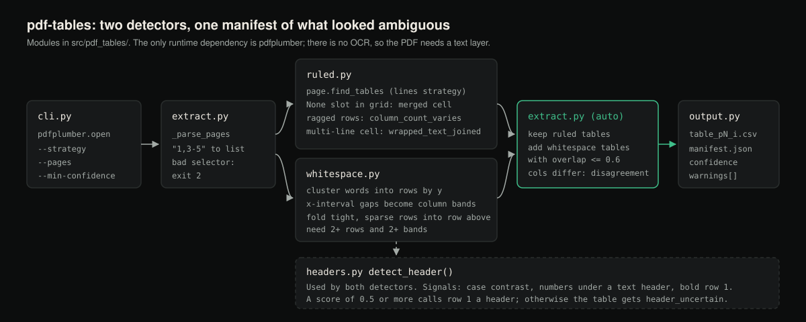

# pdf-tables

Extract tables from PDFs into CSV, and get told which of the extracted tables
you need to check by hand.

**Status:** version 0.1.0, not published to PyPI. Tested on PDFs generated with
reportlab; real-world documents (scans, multi-column layouts) have not been part
of the test suite. CI runs the tests on Linux, macOS and Windows with Python
3.10 to 3.13.

## Demo



*Real terminal capture of the [Quick start](#quick-start) PDF: the merged row is extracted and flagged, and an out-of-range `--pages` is an error instead of "0 tables".*

## What it does

`pdf-tables` reads a PDF, finds tables on each page with two independent
detection strategies, and writes one CSV per table plus a JSON manifest. For
every table the manifest records its page, bounding box, which strategy found
it, a `confidence` score, and a list of `warnings` that say exactly what looked
ambiguous.

## Why

Most table extractors guess silently. Give one a PDF with no ruling lines, a
merged cell, or a column that wraps onto a second line, and it writes a
confidently wrong CSV that you find during reconciliation days later, or never.
`pdf-tables` reports uncertainty instead of hiding it: run it over 200 tables
and it points at the few that need a human, instead of making you check all 200.

## How detection works

### Ruled tables

When a table has ruling lines (a grid of horizontal and vertical rules),
`pdf-tables` uses `pdfplumber`'s line-intersection table finder to build the
cell grid from where those rules cross, then adds its own checks:

- A grid position that pdfplumber returns as `None` (absorbed by a spanning
  neighbour) is direct evidence of a **merged cell**, read from the ruling
  geometry rather than guessed.
- A cell whose text spans several lines is already bounded by its ruling box,
  so the lines are joined and reported as `wrapped_text_joined`. That warning is
  informational and does not lower confidence.
- Column count is compared across rows; if it varies, the grid itself is
  inconsistent and the table is flagged.
- The first row's font weight (from character-level font metadata) feeds
  header detection.

### Whitespace-aligned tables

This is the harder and more common case: no ruling lines, just text placed in
visual columns. `pdf-tables` implements this itself:

1. Words are clustered into rows by vertical position.
2. The x-intervals of all words across a run of rows are merged, and gaps
   between merged intervals wider than a threshold (derived from the page's
   average character width) become **column band boundaries**.
3. Each word goes to the band its centre falls in; words in the same row and
   band are joined into one cell.
4. Rows that sit closer together than the page's typical line spacing and are
   mostly empty are treated as **wrapped-text continuations** and folded into
   the row above. If the continuation line has more than one non-empty cell,
   the fold is flagged as uncertain.
5. A run of rows only becomes a table when it has at least two rows and at
   least two stable column bands, so a single column of prose or a lone label
   is left alone.

### Auto mode

`--strategy auto` (the default) runs ruled detection first, because rules are
unambiguous when present, then runs whitespace detection over the same page.
A whitespace table that overlaps a ruled table (more than 60% of the smaller
box) is not reported separately. It only adds a `strategy_disagreement` warning
to the ruled table when the two disagree on **column count**; row counts are
expected to differ because the two strategies join wrapped lines differently.
Whitespace tables that don't overlap a ruled table are reported on their own,
so one page can mix both kinds.

## Features

- Two detection strategies, ruled and whitespace, selectable or combined.
- Per-table `confidence` score and a list of specific `warnings`.
- Merged-cell detection.
- Wrapped-cell handling, with the ambiguous whitespace case reported as such.
- Header-row detection with a confidence score built from case contrast,
  numeric columns under a text header, and bold font. When no signal is strong
  enough the table gets `header_uncertain` instead of a guess.
- `--pages` selector, `--strategy` override, `--min-confidence` filter.
- One CSV per table plus a single `manifest.json` for triaging results in code.
- No system dependencies (no Java, no poppler). The only runtime dependency is
  `pdfplumber`.

## Installation

This project is not on PyPI. **`pip install pdf-tables` installs an unrelated
package with the same name.** Install from a clone instead:

```bash
git clone https://github.com/hellpuffyt/pdf-tables && cd pdf-tables
pip install .            # or: pip install -e ".[dev]" for development
```

Requires Python 3.10 or newer.

## Quick start

No sample PDF ships with the repository (test fixtures are generated at test
time). This builds a small ruled table with a merged row using `reportlab`,
which the `dev` extra installs:

```bash
python - <<'PY'
from reportlab.lib import colors
from reportlab.platypus import SimpleDocTemplate, Table, TableStyle

t = Table([["Item", "Q1", "Q2"], ["Widgets", "10", "12"],
           ["Discontinued", "", ""], ["Gears", "7", "9"]])
t.setStyle(TableStyle([("GRID", (0, 0), (-1, -1), 1, colors.black),
                       ("SPAN", (0, 2), (2, 2))]))
SimpleDocTemplate("merged.pdf").build([t])
PY
pdf-tables merged.pdf -o out/
```

```
Extracted 1 table(s) from merged.pdf
  page 1 table 0: strategy=ruled rows=4 cols=3 confidence=0.90 warnings=[possible_merged_cell:rows=[2]]
Manifest: out/manifest.json
```

```console
$ cat out/table_p1_0.csv
Item,Q1,Q2
Widgets,10,12
Discontinued,,
Gears,7,9
$ pdf-tables merged.pdf --pages 99
error: --pages '99' selects no page; the PDF has 1 page(s)
```

The merged row keeps its text in the first column and leaves the spanned
cells empty.

## Usage

```bash
pdf-tables report.pdf
pdf-tables report.pdf --out extracted/
pdf-tables report.pdf --strategy ruled
pdf-tables report.pdf --pages "1,3-5"
pdf-tables report.pdf --min-confidence 0.7
```

```
usage: pdf-tables [-h] [-o OUT] [--strategy {auto,ruled,whitespace}]
                  [--pages PAGES] [--min-confidence MIN_CONFIDENCE]
                  [--version]
                  pdf

Extract tables from a PDF into CSV files, reporting confidence and warnings
when the table structure is ambiguous.

positional arguments:
  pdf                   Path to the input PDF file

options:
  -h, --help            show this help message and exit
  -o OUT, --out OUT     Output directory for CSVs and manifest.json (default:
                        tables_out)
  --strategy {auto,ruled,whitespace}
                        Detection strategy to use (default: auto)
  --pages PAGES         Page selector, 1-based, e.g. "1,3-5" (default: all
                        pages)
  --min-confidence MIN_CONFIDENCE
                        Drop tables with confidence below this threshold
                        (0.0-1.0)
  --version             show program's version number and exit
```

`--pages` drops page numbers beyond the document, but a selector that is
malformed (`x`), reversed (`3-1`) or selects no existing page (`99` on a
one-page PDF) is an error rather than a silent "0 tables".

Exit codes: `0` on success (including when no tables are found), `2` when the
input file does not exist or `--pages` is invalid, `1` when the PDF cannot be
processed.

**Opening the CSVs in a spreadsheet:** cell text is written exactly as it
appears in the PDF. A cell beginning with `=`, `+`, `-` or `@` from an
untrusted PDF can be interpreted as a formula by Excel or LibreOffice; import
the CSV as text if the source is not trusted.

## Library usage

```python
import pdfplumber
from pdf_tables import extract_tables

with pdfplumber.open("report.pdf") as pdf:
    tables = extract_tables(pdf, strategy="auto", min_confidence=0.5)

for table in tables:
    print(table.page, table.strategy, table.confidence, table.warnings)
    for row in table.rows:
        print(row)
```

`extract_tables` also takes `pages="1,3-5"` and raises
`pdf_tables.extract.PageSelectionError` for an invalid selector. Each result is
a `TableResult` dataclass (`page`, `index`, `strategy`, `bbox`, `rows`,
`header`, `header_detected`, `header_confidence`, `confidence`, `warnings`).

## Output format

Running `pdf-tables report.pdf -o out/` writes one CSV per table, named
`table_p<page>_<index>.csv`, plus `manifest.json`:

```
out/
  table_p1_0.csv
  manifest.json
```

For a one-page PDF with a bold-headed Name/Role/Notes grid, the manifest is:

```json
{
  "source": "report.pdf",
  "n_tables": 1,
  "tables": [
    {
      "page": 1,
      "index": 0,
      "strategy": "ruled",
      "bbox": [217.695, 78.0, 394.305, 132.0],
      "n_rows": 3,
      "n_cols": 3,
      "header_detected": true,
      "header_confidence": 0.5,
      "header": ["Name", "Role", "Notes"],
      "confidence": 1.0,
      "warnings": [],
      "csv": "table_p1_0.csv"
    }
  ]
}
```

(The real file is indented with one array element per line; arrays are shown
inline here for space.) `bbox` is `[x0, top, x1, bottom]` in PDF points from
the top-left of the page.

## Confidence and warnings reference

| Warning | Meaning |
|---|---|
| `column_count_varies` | Rows have different cell counts (whitespace: different numbers of non-empty cells), so the grid is inconsistent. |
| `possible_merged_cell:rows=[...]` | One or more rows contain a cell that spans a column boundary (ruled: pdfplumber's absorbed-cell marker; whitespace: a word straddling a band edge). |
| `wrapped_text_joined:rows=[...]` | Ruled only: a cell's lines were joined into one value. Informational, since the ruling box makes the cell boundary unambiguous. |
| `text_overflow_band:rows=[...]` | Whitespace only: a word extends well past its column band's right edge, so the band boundaries may be slightly off for that row. |
| `continuation_rows_joined:rows=[...]` | Whitespace only: tightly spaced, mostly empty rows were folded into the row above as wrapped text. |
| `continuation_join_uncertain:rows=[...]` | A continuation line had more than one non-empty cell, so which row it continues is less certain. |
| `header_uncertain` | No signal (case, numeric contrast, bold font) was strong enough to call the first row a header. |
| `insufficient_rows_for_header` | The table has a single row, so there is nothing to compare a header against (ruled tables only; whitespace tables need two rows). |
| `strategy_disagreement:whitespace_rows=N,whitespace_cols=M` | Auto mode only: the whitespace strategy, run over the same region as a ruled table, found a different column count. |

`confidence` (0.0 to 1.0) starts at 1.0 and is reduced for each structural
issue:

| Issue | Ruled | Whitespace |
|---|---|---|
| `column_count_varies` | -0.35 | -0.25 |
| merged cell | -0.10 | -0.20 |
| fewer than two columns | -0.40 | (not reported as a table) |
| `text_overflow_band` | | -0.10 |
| `continuation_join_uncertain` | | -0.15 |
| `strategy_disagreement` (auto) | -0.15 | |

Header warnings and the informational joins don't change `confidence`; header
certainty is reported separately as `header_confidence`. A confidence of `1.0`
with no warnings means the table's structure passed every check this tool
runs. It says nothing about whether the text layer itself is accurate.

## Examples

Extract every table, then list the ones that scored below 0.7 so you know which
to review:

```bash
pdf-tables quarterly_report.pdf --out out/
python -c "import json; m = json.load(open('out/manifest.json')); \
    [print(t['csv'], t['confidence'], t['warnings']) for t in m['tables'] if t['confidence'] < 0.7]"
```

(`--min-confidence 0.7` would drop those tables from the output entirely,
including from the manifest.)

Force whitespace-only detection on an OCR'd PDF with no ruling lines:

```bash
pdf-tables scanned.pdf --strategy whitespace
```

## Architecture

Diagram of the pipeline (a drawing, not a screenshot):



```
src/pdf_tables/
  models.py       TableResult dataclass shared by both strategies
  ruled.py        Ruled-table detection (line intersections + own heuristics)
  whitespace.py   Whitespace-aligned detection (x-coordinate gaps to column bands)
  headers.py      Header-row confidence heuristic
  util.py         Shared helpers (bold-ratio detection, median)
  extract.py      Page selection, strategy dispatch, auto-mode merge, filtering
  output.py       CSV + manifest.json writers
  cli.py          Command-line interface
```

## Testing

```bash
pip install -e ".[dev]"
pytest
ruff check .
mypy
```

The suite has 93 tests and generates every fixture PDF at test time with
`reportlab`; no binary PDFs are committed. Fixtures cover ruled tables,
whitespace-aligned tables, a merged cell, wrapped text (ruled and whitespace),
varying column counts, multi-page PDFs, a page with two tables found by
different strategies, prose-only pages and blank pages. Each ambiguity warning
is checked both for firing when it should and for staying quiet on a clean
table. `mypy` runs in strict mode on `src/`.

CI (`.github/workflows/ci.yml`) runs `pytest` on Ubuntu, macOS and Windows for
Python 3.10 to 3.13, runs `ruff` and `mypy`, and does a smoke test that builds a
wheel, extracts a generated ruled PDF with the CLI and checks the CSV.

Beyond the test suite, 10 random tables (2 to 6 columns, 3 to 12 rows) were
rendered to PDF with reportlab both with grid lines and as plain positioned
text; `--strategy ruled` and `--strategy whitespace` reproduced all 20 tables
cell for cell. See [docs/PRODUCTION_READINESS.md](docs/PRODUCTION_READINESS.md).

## Limitations

- Whitespace detection groups rows into a table using vertical-gap and
  column-band heuristics. A table embedded in a paragraph with similar line
  spacing can be missed or merged with the prose.
- Rotated or skewed page content is not corrected for.
- Confidence scores are heuristic penalties, not statistical guarantees.
- No OCR: this works on text already present in the PDF. Scanned images
  without a text layer produce no tables.
- Nested or irregular ruled tables (a table inside a table cell) come out the
  way pdfplumber's line finder sees them, which may split or merge complex
  layouts.

## Security

`pdf-tables` only reads the PDF you pass it and writes CSV and JSON files to
the output directory you choose. It makes no network requests. As with any PDF
parser, sandbox it when processing untrusted PDFs in a sensitive context:
malformed input could trigger bugs in the underlying pdfplumber/pdfminer stack.
Report vulnerabilities as described in [SECURITY.md](SECURITY.md).

## Contributing

See [CONTRIBUTING.md](CONTRIBUTING.md). `pytest`, `ruff check .` and `mypy`
must all pass, and new fixtures go in `tests/pdf_builders.py` rather than as
committed PDFs.

## License

MIT, see [LICENSE](LICENSE).
